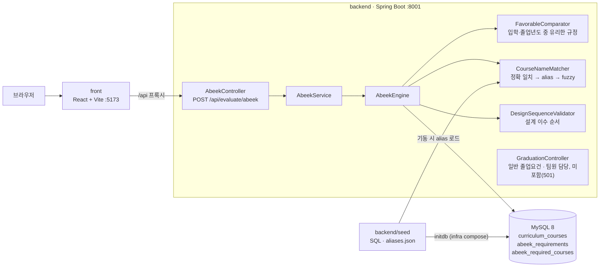

# 세종대 공학인증(ABEEK) 졸업요건 판정 시스템

세종대학교 공과대학 학생이 **공학인증(ABEEK) 졸업요건을 충족했는지** 이수 과목 목록만으로 바로 확인할 수 있게 만든 해커톤 프로젝트입니다. 인증 요건은 학과·입학년도마다 다르고 교과과정 개편으로 과목명도 해마다 바뀌어, 학생이 교과과정표와 성적표를 직접 대조하면 놓치기 쉽습니다. 학과·연도별 교과과정과 인증 규칙을 DB 시드로 정리하고, 과목 목록을 보내면 학점·전공 인증필수·BSM/MSC 필수·교양·설계 이수 순서를 한 번에 판정해 부족한 항목을 돌려줍니다.

**개발:** 2026 세종 해커톤 (5인 팀)

> 5인 해커톤에서 ABEEK 판정 파트(판정 엔진·시드 데이터·인프라·프론트 API 연동) 담당. 이 저장소들은 제 담당분을 정리한 것이며, 일반 졸업요건 판정은 팀원 담당으로 포함되지 않았습니다. 구현에 Cursor를 활용했고, 규칙 해석·데이터 검증·테스트는 직접 확인했습니다.

## 저장소

| 저장소 | 내용 | 스택 |
|--------|------|------|
| **sejonghackathon** (이 저장소) | 프로젝트 소개 — 시작점 | — |
| [sejonghackathon-backend](https://github.com/leejunyoung0610/sejonghackathon-backend) | ABEEK 판정 엔진·API, 학과별 시드 데이터, 테스트·CI | Java 17, Spring Boot 3, JPA, MySQL 8, Gradle |
| [sejonghackathon-front](https://github.com/leejunyoung0610/sejonghackathon-front) | 판정 UI, 백엔드 API 연동 | React, Vite, TypeScript |
| [sejonghackathon-infra](https://github.com/leejunyoung0610/sejonghackathon-infra) | 전체 실행 환경 (시드 자동 적재) | Docker Compose, MySQL 8 |

## 아키텍처



## 판정 항목

- **학점** — 카테고리(major·design·bsm/msc·liberal)마다 입학년도와 졸업년도 규정 중 학생에게 유리한(최소 학점이 낮은) 쪽 적용
- **전공 인증필수 / BSM·MSC 필수 / 교양 필수** — 미이수 과목 목록 반환
- **교양 선택** — 3영역 중 2영역 이상
- **설계 이수 순서** — basic → element → capstone, 학과별 capstone 인정 개수(택1 등)
- **과목명 매칭** — 교과과정 개편·성적표 표기 차이를 정확 일치 → 학과별 alias → fuzzy(차수 토큰·모호성 검사) → 교양 카탈로그 → 성적표 이수구분 순으로 해석

## 데이터

11개 학과(트랙 포함 13개)·2021~2026 교과과정, 교과목 행 3,929개(학과·과목 조합 1,083개).

| 항목 | 값 |
|------|-----|
| 학과 | 11개 학과, 13개 라벨 (AI로봇학과 통합·무인이동체·스마트기기 트랙) |
| 교과과정 연도 | 2021~2026 |
| `curriculum_courses` | 3,929행 (학과×연도×과목), 학과·과목 조합 1,083개, 고유 과목명 648개 |
| `abeek_requirements` | 272행 (학과·연도·카테고리별 최소 학점) |
| `abeek_required_courses` | 676행 (BSM/MSC 필수, 교양 필수·선택) |
| 과목명 alias | 13개 파일, 116개 |

수치는 시드 SQL 파싱 결과와 적재된 DB 조회 결과를 대조해 확인했습니다.

## API 예시 — `POST /api/evaluate/abeek`

2023년 입학·2026년 졸업 예정인 컴퓨터공학과 학생의 과목 6개를 보낸 실제 요청과 응답입니다.

```bash
curl -X POST http://localhost:8001/api/evaluate/abeek \
  -H 'Content-Type: application/json' -d @request.json
```

요청 (`courseName`, `semester`, `grade`, `courseType`. 저장된 세션으로 판정할 때는 `{"sessionId": "..."}`만 보냄)

```json
{
  "department": "컴퓨터공학과",
  "enrollmentYear": 2023,
  "graduationYear": 2026,
  "courses": [
    {"courseName": "기초미적분학", "semester": "2023-1", "grade": "A0", "courseType": "기필"},
    {"courseName": "일반물리학1", "semester": "2023-1", "grade": "B+", "courseType": "기필"},
    {"courseName": "C프로그래밍및실습", "semester": "2023-1", "grade": "A+", "courseType": "전필"},
    {"courseName": "공학설계기초(산학프로젝트입문)", "semester": "2023-2", "grade": "A0", "courseType": "전필"},
    {"courseName": "공업수학2", "semester": "2023-2", "grade": "B0", "courseType": "기필"},
    {"courseName": "확률통계및프로그래밍", "semester": "2024-1", "grade": "A0", "courseType": "기필"}
  ]
}
```

응답에서 볼 부분:

- `creditResults` / `favorableSummary` — 카테고리별 필요·이수 학점과 적용 연도. 예: major는 입학년도(60) 대신 졸업년도 규정(45)이 적용됨
- `bsmCheck.missing`에 `공업수학1`이 남아 있음 — 학생이 들은 것은 `공업수학2`이므로 맞는 결과 (아래 "알려진 문제와 수정" 참고)
- `courseNameAliases` — `확률통계및프로그래밍`을 학과 alias로 `확률과통계및프로그래밍`에 매칭

<details>
<summary>응답 전체</summary>

```json
{
  "overallPass": false,
  "originalDepartment": "컴퓨터공학과",
  "resolvedDepartment": "컴퓨터공학과",
  "creditResults": [
    {
      "category": "bsm",
      "required": 18,
      "earned": 12.0,
      "satisfied": false,
      "shortage": 6.0,
      "appliedYear": 2023,
      "enrollmentValue": 18,
      "graduationValue": 18
    },
    {
      "category": "design",
      "required": 10,
      "earned": 3.0,
      "satisfied": false,
      "shortage": 7.0,
      "appliedYear": 2026,
      "enrollmentValue": 12,
      "graduationValue": 10
    },
    {
      "category": "liberal",
      "required": 14,
      "earned": 0.0,
      "satisfied": false,
      "shortage": 14.0,
      "appliedYear": 2023,
      "enrollmentValue": 14,
      "graduationValue": 14
    },
    {
      "category": "major",
      "required": 45,
      "earned": 6.0,
      "satisfied": false,
      "shortage": 39.0,
      "appliedYear": 2026,
      "enrollmentValue": 60,
      "graduationValue": 45
    }
  ],
  "requiredMajorCheck": {
    "satisfied": false,
    "missing": [
      "자료구조및실습",
      "디지털시스템",
      "알고리즘및실습",
      "운영체제",
      "컴퓨터네트워크",
      "Capstone디자인(산학협력프로젝트)",
      "SW-AI종합설계"
    ],
    "appliedYear": 2026,
    "enrollmentRequiredCount": 10,
    "graduationRequiredCount": 9
  },
  "designSequence": {
    "valid": true,
    "validCredits": 3.0,
    "warnings": []
  },
  "liberalCheck": {
    "valid": false,
    "requiredTaken": [],
    "requiredMissing": [
      "대학영어",
      "문제해결을위한글쓰기와발표",
      "서양철학:쟁점과토론"
    ],
    "electiveTaken": [],
    "electiveGroupsCovered": []
  },
  "bsmCheck": {
    "valid": false,
    "taken": [
      "기초미적분학",
      "일반물리학1",
      "확률과통계및프로그래밍"
    ],
    "missing": [
      "공업수학1",
      "선형대수및프로그래밍",
      "이산수학및프로그래밍"
    ]
  },
  "favorableSummary": {
    "major": {
      "appliedYear": 2026,
      "minCredits": 45,
      "enrollmentValue": 60,
      "graduationValue": 45
    },
    "design": {
      "appliedYear": 2026,
      "minCredits": 10,
      "enrollmentValue": 12,
      "graduationValue": 10
    },
    "bsm": {
      "appliedYear": 2023,
      "minCredits": 18,
      "enrollmentValue": 18,
      "graduationValue": 18
    },
    "liberal": {
      "appliedYear": 2023,
      "minCredits": 14,
      "enrollmentValue": 14,
      "graduationValue": 14
    }
  },
  "unmappedCourses": [],
  "courseNameAliases": {
    "확률통계및프로그래밍": "확률과통계및프로그래밍"
  }
}
```

</details>

## 실행

자세한 내용은 [sejonghackathon-infra](https://github.com/leejunyoung0610/sejonghackathon-infra) README에 있습니다.

```bash
git clone https://github.com/leejunyoung0610/sejonghackathon-infra.git
cd sejonghackathon-infra && ./scripts/clone-all.sh   # backend·front를 형제 폴더로 클론
docker compose up --build                             # front :5173, backend :8001, MySQL :3306
```

## 알려진 문제와 수정

**과목명 fuzzy 매칭의 false pass (수정됨)** — 이전 판정 엔진은 Jaro-Winkler 점수 0.92 이상이면 무조건 같은 과목으로 보아 `일반물리학및실험2`가 필수 `일반물리학및실험1`(0.956)을, `공업수학2`가 `공업수학1`(0.92)을 충족하는 것으로 판정했습니다. 위 예시 요청도 수정 전에는 `bsmCheck.taken`에 `공업수학1`이 들어가고 `courseNameAliases`에 `"공업수학2": "공업수학1"`이 생겼습니다. 과목명 끝의 차수 토큰(1/2, I/II, (1), A/B 등)이 정확히 같아야 하고, 같은 해에 함께 개설된 과목과 점수가 비슷하면 모호한 것으로 보도록 바꿨습니다.

- 시드 과목명 654개 전 쌍 비교: 기존 fuzzy 일치 216쌍 중 차수가 다른 128쌍 제거, 새로 생긴 일치 0
- 13개 학과 라벨과 입학·졸업년도 조합으로 만든 가상 학생 476건의 판정 비교: `overallPass` 변화 없음, 미수강 과목 인정 8건 제거, 서로 다른 차수 과목이 합쳐져 덜 집계되던 학점 32건 교정
- 영향: 2021 `일반화학` ↔ 2022+ `일반화학1`처럼 한쪽에만 차수가 붙은 개편 명칭은 자동으로 묶이지 않으므로, 같은 과목이면 학과 `aliases.json`에 명시해야 함

정리하면서 함께 고친 것:

- 시드 한글 깨짐 — MySQL initdb 클라이언트가 latin1로 읽어 `docker compose`로 띄운 DB에서 모든 학과가 "지원하지 않는 학과"로 거부되던 문제 (시드마다 `SET NAMES utf8mb4`)
- 세션 조회·세션 기반 판정이 항상 500(LazyInitializationException)이던 문제 (`@EntityGraph`로 과목까지 조회)
- 실행 환경 — compose의 비공개 AI 저장소 빌드 의존, 이미지의 `app.jar`를 가리는 바인드 마운트, 이미지에 과목명 alias 누락(조용히 빈 값으로 동작), 로컬 실행 시 백엔드 기본 DB 포트(3307)와 compose MySQL(3306) 불일치

## 테스트·CI

테스트 62개 — 단위 51개(DB 불필요), 통합 11개(`@SpringBootTest`, 시드가 적재된 MySQL 필요). GitHub Actions가 MySQL 8 서비스 컨테이너에 시드를 적재하고 전체를 실행합니다 ([`ci.yml`](https://github.com/leejunyoung0610/sejonghackathon-backend/blob/main/.github/workflows/ci.yml)).

## 작성자

[leejunyoung0610](https://github.com/leejunyoung0610)
